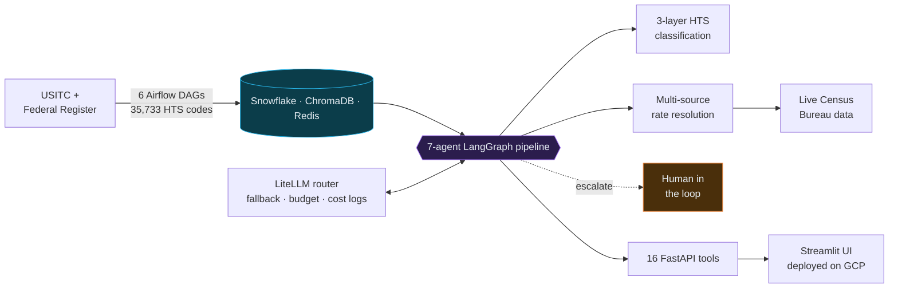
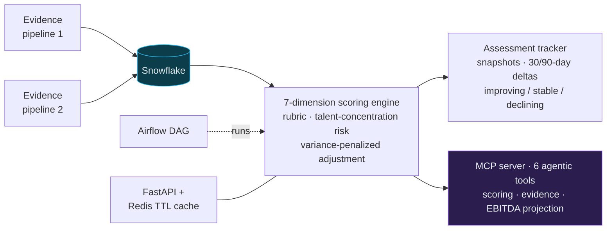
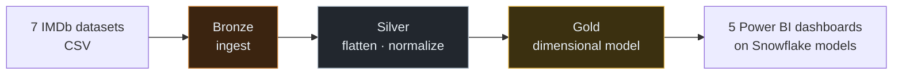

<div align="center">



<br>

[**Choose your path**](#choose-your-path) · [**Projects**](#projects) · [**Career DAG**](#career-dag) · [**Engineering habits**](#engineering-habits) · [**Stack**](#stack) · [**Contact**](#contact)

</div>

<br>

I build the plumbing that data and AI systems run on (ingestion, orchestration, warehouses) and the agents that sit on top of it. M.S. in Information Systems at Northeastern, graduating Dec 2026, based in Boston.

## Choose your path

This README has a few ways in. Pick the one that fits why you're here.

<details>
<summary><b>👔 I'm a recruiter</b>: give me the 30-second version</summary>

<br>

- **Who:** Data engineer · M.S. Information Systems, Northeastern (Dec 2026) · Boston, MA
- **Proof:**
  - **TariffIQ**: a 7-agent LangGraph system over 35,733 HTS codes
  - **PE Org-AI-R**: a 7-dimension scoring engine with an MCP server
  - **Thesis AI internship**: 100K+ records ingested daily, 20 FastAPI endpoints
- **Toolbox:** Python, SQL, Airflow, Snowflake, FastAPI, LangGraph, Docker, GCP / AWS / Azure
- **Reach me:** [LinkedIn](https://www.linkedin.com/in/ayush-fulsundar) · [Email](mailto:fulsundar.a@northeastern.edu)

</details>

<details>
<summary><b>🛠️ I'm an engineer</b>: show me how it's built</summary>

<br>

Open the project cards under [Projects](#projects). Each one has an architecture sketch and the numbers behind it. Then skim [Engineering habits](#engineering-habits), where every claim points back to something I actually shipped.

</details>

<details>
<summary><b>🤝 I want to build something together</b></summary>

<br>

Working on agent pipelines, data platforms, or tariff and finance data? [**▶ Trigger me**](mailto:fulsundar.a@northeastern.edu?subject=Let%27s%20build%20something) and I'll take it from there.

</details>

## Projects

Click a card to expand it.

<details open>
<summary><b>TariffIQ</b> · multi-agent tariff intelligence · <i>Mar to Apr 2026</i></summary>

<br>

A US import tariff intelligence platform. Airflow keeps the HTS catalog fresh, and a 7-agent LangGraph pipeline classifies products, resolves tariff rates from multiple sources, and escalates to a human when needed. A LiteLLM router sits underneath every model call.



- **Numbers:** 35,733 HTS codes · 6 Airflow DAGs · 7 agents · 16 FastAPI tools
- **Stack:** `Python` `FastAPI` `LangGraph` `LiteLLM` `Snowflake` `Airflow` `ChromaDB` `Redis` `spaCy` `GCP` `Docker` `Streamlit`
- **Repo:** [BigDataIA-Spring26-Team-03/TarrifIQ](https://github.com/BigDataIA-Spring26-Team-03/TarrifIQ)

</details>

<details>
<summary><b>PE Org-AI-R Platform</b> · AI-readiness scoring for private equity · <i>Jan to Mar 2026</i></summary>

<br>

Scores how ready an organization is for AI across 7 dimensions, snapshots every score over time, and exposes the whole thing to agents through an MCP server.



- **Numbers:** 7 scoring dimensions · 30 and 90-day score deltas · 6 MCP tools
- **Stack:** `Python` `FastAPI` `Snowflake` `Redis` `Airflow` `LangGraph` `MCP` `AWS S3` `GCP` `Docker` `Streamlit` `Pydantic`
- **Repo:** [BigDataIA-Spring26-Team-03/PE_OrgAIR_CaseStudy5](https://github.com/BigDataIA-Spring26-Team-03/PE_OrgAIR_CaseStudy5)

</details>

<details>
<summary><b>IMDb Analytics Pipeline</b> · medallion architecture on Azure · <i>Feb to Mar 2025</i></summary>

<br>

Seven IMDb datasets modeled into a dimensional schema, moved through a Bronze, Silver and Gold pipeline in Azure Data Factory, and surfaced in Power BI.



- **Numbers:** 7 datasets · 5 dashboards
- **Stack:** `Azure Data Factory` `Snowflake` `Alteryx` `Python (YData)` `ER Studio` `Power BI`
- **Repo:** [ayushfulsundar2412/IMDBDataSetAnalysisProject](https://github.com/ayushfulsundar2412/IMDBDataSetAnalysisProject)

</details>

## Career DAG

My path so far, drawn the way I'd draw a pipeline. Green tasks succeeded, amber is running, dashed is queued.

```mermaid
flowchart LR
    A["B.IT<br/>Univ. of Mumbai<br/>2020 to 24"] --> B["Data Eng Intern<br/>TCR Innovation<br/>May to Jul 2023"]
    B --> M["M.S. Info Systems<br/>Northeastern<br/>to Dec 2026"]
    M --> C["IMDb pipeline<br/>Feb to Mar 2025"]
    C --> D["Data Eng Intern<br/>Thesis AI<br/>Sep to Dec 2025"]
    D --> E["PE Org-AI-R<br/>Jan to Mar 2026"]
    E --> F["TariffIQ<br/>Mar to Apr 2026"]
    F --> G["Next task<br/>data and AI<br/>engineering roles"]

    classDef done fill:#0f2d1a,stroke:#2ea043,color:#e6edf3
    classDef running fill:#3b2e0a,stroke:#d29922,color:#e6edf3
    classDef queued fill:#161b22,stroke:#8b949e,stroke-dasharray:4 3,color:#e6edf3
    class A,B,C,D,E,F done
    class M running
    class G queued
```



## Engineering habits

The things I keep doing, and where they show up.

| Habit | Receipts |
|---|---|
| **Fallbacks over failures** | Multi-source API fallback across 4 providers at Thesis AI. Automatic provider fallback in TariffIQ's LiteLLM router. |
| **Cost is a feature** | Daily budget enforcement and per-call token cost logging in TariffIQ. |
| **Humans in the loop** | HITL escalation built into TariffIQ's 7-agent pipeline. |
| **Typed contracts** | Pydantic schema validation and rate-limit handling across 20 FastAPI endpoints at Thesis AI. 16 FastAPI tools in TariffIQ. |
| **Track change over time** | Point-in-time score snapshots with 30 and 90-day deltas and trend classification in the PE platform. |
| **Cache on purpose** | Redis TTL caching in the PE platform. |

## Stack

| Layer | Tools |
|---|---|
| **Languages** | `Python` `SQL` `Java` `JavaScript` |
| **Orchestration and ETL** | `Apache Airflow` `Azure Data Factory` `Databricks` `Talend` `Alteryx` `Docker` |
| **Storage** | `Snowflake` `PostgreSQL` `pgvector` `ChromaDB` `Redis` `MySQL` `MongoDB` |
| **AI and agents** | `LangGraph` `LiteLLM` `MCP` `spaCy` |
| **APIs and libraries** | `FastAPI` `Pydantic` `Pandas` `NumPy` `Streamlit` |
| **Cloud** | `GCP` `AWS S3` `Azure` |
| **BI** | `Power BI` `Tableau` `Looker Studio` `Excel` |

## Contact

```bash
$ airflow dags trigger hello_ayush
```

[**▶ Trigger the DAG (email me)**](mailto:fulsundar.a@northeastern.edu?subject=Hello%20Ayush) · [LinkedIn](https://www.linkedin.com/in/ayush-fulsundar)

<sub>The banner is one hand-written SVG and the diagrams are Mermaid, so everything here is plain text in this repo.</sub>
